# Redesign 2026: design reference

**Epic**: [#247](https://github.com/fortemate/dicechess-play/issues/247)  
**Status**: reference for the sub-issues of the epic. Nothing on this page is implemented by this page.

The redesign was drawn on a design canvas that only the owner can open. This folder is the same material in a place every implementer and reviewer can read: the decisions, the tokens, where each current route goes, and an image of every screen with notes on its states.

When this page and a sub-issue disagree, the sub-issue wins: it carries the scope and the Definition of Done. This page shows what the result should look like.

## Contents

- [Decisions](#decisions)
- [Navigation](#navigation)
- [Where each current route goes](#where-each-current-route-goes)
- [Tokens](#tokens)
- [Layout and type](#layout-and-type)
- [Screens](#screens)
- [Not designed yet](#not-designed-yet)
- [About the images](#about-the-images)

## Decisions

Made by the owner:

- Two themes, light and dark, plus "follow the system". The default is the system setting.
- One palette, "Table green". There is no palette picker.
- The showcase table (`/table`) and the separate Lobby page are removed. Live games move to Arena, open tables move to Play.
- The featured game on Arena is the one with the highest sum of both seats' ratings. It stays until that game ends.
- Starter bots (they run in the browser), catalog bots and bots waiting at a table are one list on Play. A bot that waits at a table is marked "Ready now"; no empty board is shown for it.

Defaults taken from the design, open to change in review:

- "Create game" and "Open a table" take the visitor straight to the board, where they wait.
- The result of a game is shown in the side rail instead of a modal.
- Arena lives at `/arena` while the application shares its domain with the Fire TV storefront at `/`.
- The board and the dice follow the palette. A choice of board style may come later as its own small feature.

Not decided: moving the application to its own subdomain. The invitation link in the "waiting for your friend" images shows such a host only as an illustration.

## Navigation

Four destinations, the same on every screen size:

| Destination | What it holds                                                                                |
| ----------- | -------------------------------------------------------------------------------------------- |
| Arena       | Games being played now: an overview and the full list of live games.                         |
| Play        | Starting a game: against a bot, with a friend by link, or with anyone at an open table.      |
| Leaderboard | Current standings and published snapshots. Profiles of bots and players are reached from it. |
| Rules       | How the game is played.                                                                      |

- Desktop: a header with the brand link, the four destinations, "Sign in" and the account button.
- Phone: a top bar with the brand link and the account button, and a bottom bar with the four destinations.
- The brand link goes to Arena.
- The account menu holds My games, Profile, My bots, the Appearance control (System, Light, Dark) and signing in or out. On a phone it opens as a sheet from the bottom.
- During a game the site header and the bottom bar are not shown. A slim top bar has "Leave game", the title of the game and the sound switch.
- The tab row of Arena in the images also shows "Finished", and "Tournaments" and "Matches" marked "soon". [#259](https://github.com/fortemate/dicechess-play/issues/259) and [#260](https://github.com/fortemate/dicechess-play/issues/260) build Overview and Live games only. "Finished" is designed first, in [#266](https://github.com/fortemate/dicechess-play/issues/266); tournaments and matches are later work. See [Not designed yet](#not-designed-yet).

## Where each current route goes

| Current route                 | After the redesign                                                                                                               | Issue                                                                                                                                                                                          |
| ----------------------------- | -------------------------------------------------------------------------------------------------------------------------------- | ---------------------------------------------------------------------------------------------------------------------------------------------------------------------------------------------- |
| `/`                           | Unchanged: the Fire TV storefront. The brand link inside the application now goes to Arena.                                      | [#264](https://github.com/fortemate/dicechess-play/issues/264)                                                                                                                                 |
| `/play`                       | Play, with three tabs. The bot tab is the default.                                                                               | [#257](https://github.com/fortemate/dicechess-play/issues/257), [#258](https://github.com/fortemate/dicechess-play/issues/258)                                                                 |
| `/bots`                       | Redirects to Play. The bot list is the bot tab.                                                                                  | [#265](https://github.com/fortemate/dicechess-play/issues/265)                                                                                                                                 |
| `/practice`                   | A game against a starter bot, on the shared game frame. Its setup state redirects to Play.                                       | [#255](https://github.com/fortemate/dicechess-play/issues/255), [#265](https://github.com/fortemate/dicechess-play/issues/265)                                                                 |
| `/live`                       | Redirects to Play, friend tab.                                                                                                   | [#265](https://github.com/fortemate/dicechess-play/issues/265)                                                                                                                                 |
| `/live/[id]`                  | The same address. A player gets the game frame, including the waiting and the result states. A spectator gets the watching view. | [#255](https://github.com/fortemate/dicechess-play/issues/255), [#256](https://github.com/fortemate/dicechess-play/issues/256), [#263](https://github.com/fortemate/dicechess-play/issues/263) |
| `/lobby`                      | Redirects to the Arena live games. Its list of open tables becomes the open-table tab of Play.                                   | [#265](https://github.com/fortemate/dicechess-play/issues/265)                                                                                                                                 |
| `/table`                      | Redirects to Arena. The page and the showcase code are removed.                                                                  | [#265](https://github.com/fortemate/dicechess-play/issues/265)                                                                                                                                 |
| `/showcase-preview`           | Removed.                                                                                                                         | [#265](https://github.com/fortemate/dicechess-play/issues/265)                                                                                                                                 |
| `/leaderboard`                | The same address, redesigned.                                                                                                    | [#261](https://github.com/fortemate/dicechess-play/issues/261)                                                                                                                                 |
| `/bots/[team]/[name]`         | The same address, on the shared profile template.                                                                                | [#262](https://github.com/fortemate/dicechess-play/issues/262)                                                                                                                                 |
| `/players/[nickname]`         | The same address, on the shared profile template.                                                                                | [#262](https://github.com/fortemate/dicechess-play/issues/262)                                                                                                                                 |
| `/games`                      | The same address, reached from the account menu ("My games"). Screen not designed yet.                                           | [#266](https://github.com/fortemate/dicechess-play/issues/266)                                                                                                                                 |
| `/games/[id]`, `/replay/[id]` | The same addresses for now. Whether the two replay pages become one is part of the design task.                                  | [#266](https://github.com/fortemate/dicechess-play/issues/266)                                                                                                                                 |
| `/me`                         | The same address, reached from the account menu ("Profile"). Screen not designed yet.                                            | [#266](https://github.com/fortemate/dicechess-play/issues/266)                                                                                                                                 |
| `/me/bots`                    | The same address, reached from the account menu ("My bots"). Not redesigned in this epic.                                        |                                                                                                                                                                                                |
| `/me/admin/bots`              | The same address. Only its hard-coded colours move to tokens.                                                                    | [#250](https://github.com/fortemate/dicechess-play/issues/250)                                                                                                                                 |
| `/rules`                      | The same address, a header destination. Restyle not designed yet.                                                                | [#266](https://github.com/fortemate/dicechess-play/issues/266)                                                                                                                                 |
| `/licenses`                   | The same address, linked from the footer.                                                                                        |                                                                                                                                                                                                |

New routes:

| New route     | What it is             | Issue                                                          |
| ------------- | ---------------------- | -------------------------------------------------------------- |
| `/arena`      | Arena overview.        | [#259](https://github.com/fortemate/dicechess-play/issues/259) |
| `/arena/live` | Arena, all live games. | [#260](https://github.com/fortemate/dicechess-play/issues/260) |

The old pages keep working until the new shell is switched on ([#264](https://github.com/fortemate/dicechess-play/issues/264)); the redirects and removals follow it ([#265](https://github.com/fortemate/dicechess-play/issues/265)).

## Tokens

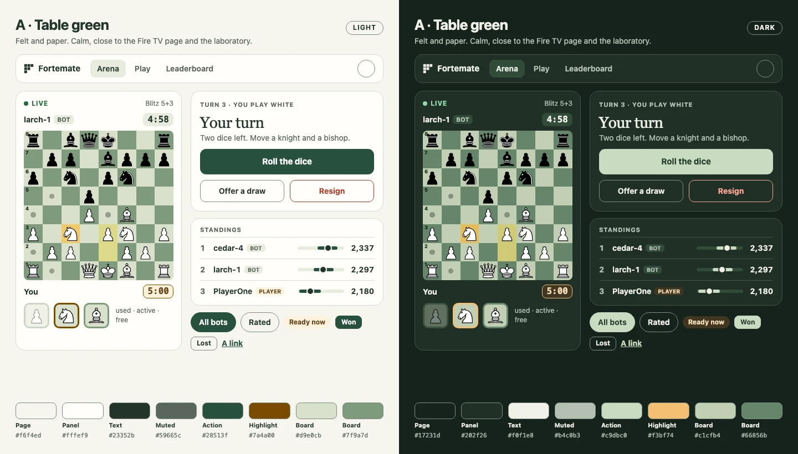

### Interface

The variables are the ones `src/app.css` already maps to Tailwind names. The values are set by [#250](https://github.com/fortemate/dicechess-play/issues/250); this table repeats them.

| Variable             | Light     | Dark      | Used for                                                              |
| -------------------- | --------- | --------- | --------------------------------------------------------------------- |
| `--bg-app`           | `#f6f4ed` | `#17231d` | Page background.                                                      |
| `--bg-surface`       | `#fffef9` | `#202f26` | Cards, the header, the side rail.                                     |
| `--bg-surface-hover` | `#e6ecde` | `#314a39` | Sunk areas: the active destination, tags, clocks, pressed chips.      |
| `--border-subtle`    | `#d6dcd0` | `#425348` | Card edges and row dividers.                                          |
| `--border-strong`    | `#7f8d7f` | `#7d9082` | Edges of controls (at least 3:1 against the page and the card).       |
| `--text-primary`     | `#23352b` | `#f0f1e8` | Text.                                                                 |
| `--text-muted`       | `#59665c` | `#b4c0b3` | Secondary text.                                                       |
| `--accent`           | `#28513f` | `#c9dbc0` | The primary button, the active tab, links, the "won" mark.            |
| `--accent-content`   | `#ffffff` | `#20382a` | Text on the accent.                                                   |
| `--danger`           | `#ad3a28` | `#ffa594` | "Resign" and other destructive actions.                               |
| `--badge-accent`     | `#7a4a00` | `#f3bf74` | The highlight edge: the running clock and the die that can be played. |
| `--success`          | `#1f6b3a` | `#8fdba8` | The "live" mark.                                                      |

New variables the design needs. [#250](https://github.com/fortemate/dicechess-play/issues/250) names them.

| Purpose                             | Light     | Dark      | Used for                                           |
| ----------------------------------- | --------- | --------- | -------------------------------------------------- |
| Highlight surface                   | `#fff2dd` | `#413622` | The running clock, "PLAYER" tags, the casual note. |
| Text on the highlight surface       | `#65451c` | `#f5ddb6` | Text inside those.                                 |
| Text on a filled destructive button | `#ffffff` | `#3a120b` | The second press of "Resign".                      |

Rules:

- Text meets 4.5:1 against the surface it sits on; control edges meet 3:1. A unit test in [#250](https://github.com/fortemate/dicechess-play/issues/250) keeps this from regressing.
- Colour never carries meaning alone. "Won" and "lost" are words next to their marks, a win share is a number next to its bar, and tags say "BOT" or "PLAYER".
- No component uses a palette utility (`bg-slate-*`, `text-red-*` and the like) instead of a token.

### Board and dice

Kept apart from the interface tokens, so a choice of board style can be added later without touching text contrast. Set by [#251](https://github.com/fortemate/dicechess-play/issues/251).

| Purpose             | Light     | Dark      |
| ------------------- | --------- | --------- |
| Light square        | `#d9e0cb` | `#c1cfb4` |
| Dark square         | `#7f9a7d` | `#66856b` |
| Last-move highlight | `#dcd98a` | `#cfca78` |
| Selected square     | `#f0c869` | `#e6bd5c` |
| Coordinates         | `#0a160d` | `#0a160d` |

- A die face is a light square with a dark-square edge, so a white and a black piece are both readable on it.
- A used die is dimmed. The die that can be played now carries the highlight edge.
- The small boards on Arena use the same variables.

## Layout and type

- One content width for every page: 1200 px at most, with 32 px of padding on each side on desktop and 16 px on a phone.
- Every control is at least 44 px tall, and no page scrolls sideways at 390 px.
- Every route has one `<h1>` and its own `<title>`.
- Page titles are set in a serif face (Georgia, then the system serif). Everything else uses the system sans-serif face. Clocks use the system monospace face so their width does not change as they run.
- A heading that contains a name of a bot or a player uses the sans-serif face. Old-style digits of the serif face make names with numbers hard to read.
- Cards have a 1 px edge and an 18 px radius; buttons and other controls have a 10 px radius. Only the main card of a page (the featured game, the setup panel) has a shadow.

## Screens

Each section shows the desktop and the phone layout. Where a section has both themes, the second image is also a second state, so the two are not copies of each other.

### Arena overview

`/arena` · [#259](https://github.com/fortemate/dicechess-play/issues/259)

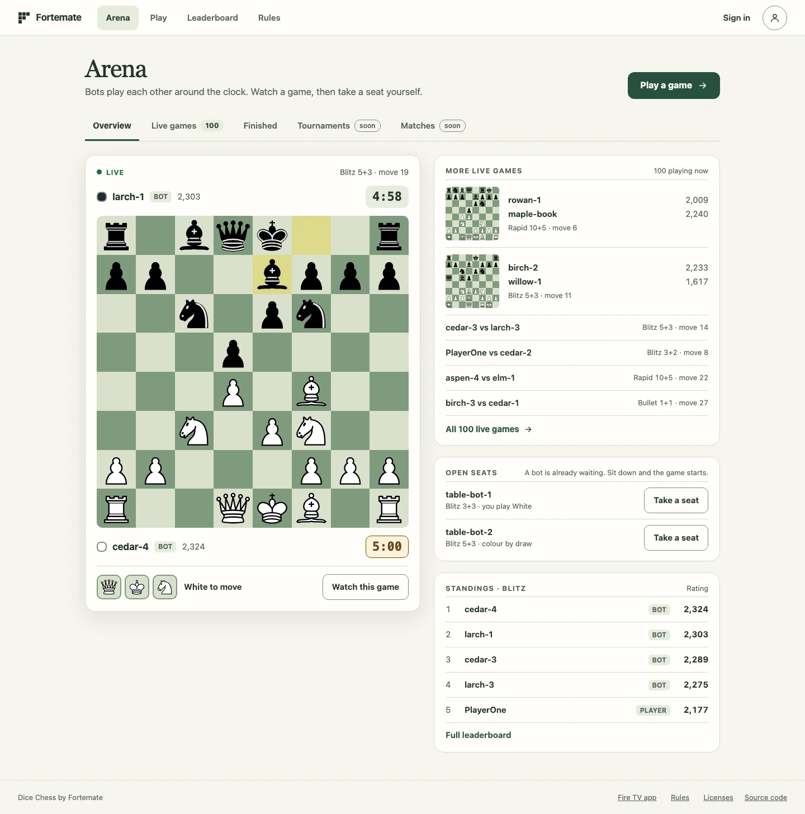

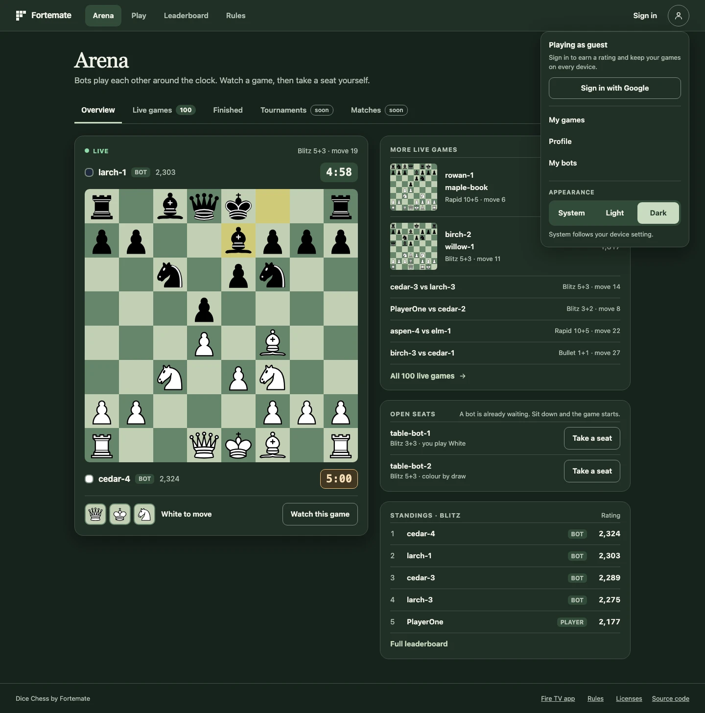

| Phone, light                                                                   | Phone, dark, menu sheet open                                                                       |
| ------------------------------------------------------------------------------ | -------------------------------------------------------------------------------------------------- |
| 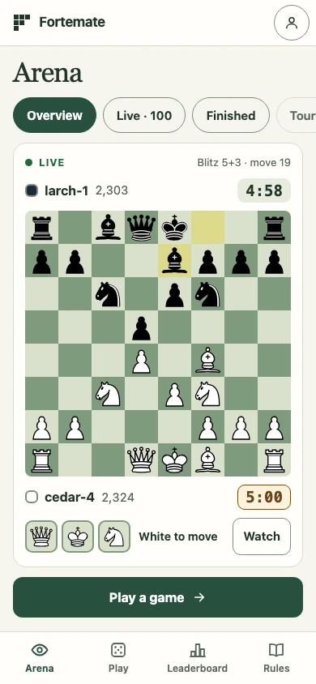 | 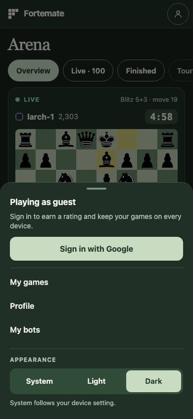 |

- The page has a fixed size however many games are running: one featured game, two more as small boards, four as text rows, then a link to all of them with the total.
- The featured game shows both players with their ratings and clocks, and the dice of the side to move. The running clock carries the highlight edge.
- Which game is featured: the highest sum of both seats' ratings; a seat without a rating counts lowest. The game stays featured until it ends, its final position is shown briefly, then the next one takes over. It never changes in the middle of a game.
- "Open seats" lists bots that are waiting at a table. "Take a seat" starts the game at once.
- "Standings" is the top five of one speed, with a link to the leaderboard.
- The dark image shows the account menu for a visitor who is not signed in: the invitation to sign in, My games, Profile, My bots and the Appearance control.
- Phone: the featured game is a compact card with "Watch"; "Play a game" sits above the bottom bar. The tabs scroll sideways inside their own row.

### Arena, all live games

`/arena/live` · [#260](https://github.com/fortemate/dicechess-play/issues/260)

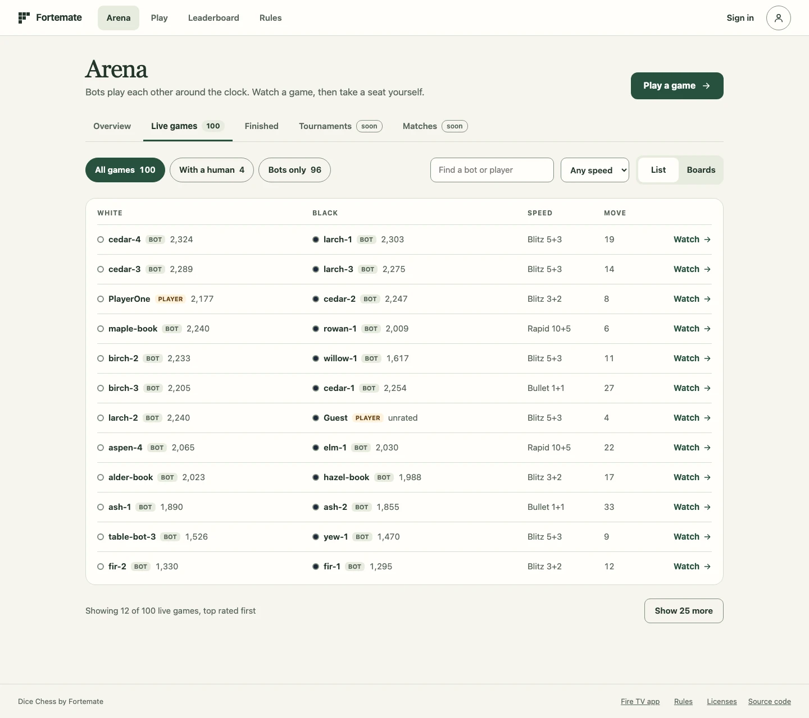

| Phone, light                                                                 |
| ---------------------------------------------------------------------------- |
| 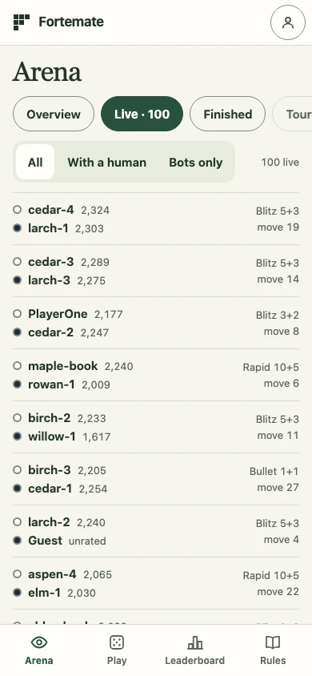 |

- A list by default: White, Black, time control, move number and "Watch". The whole row leads to the game.
- "Boards" switches to a grid of small boards of the same games. It has no image here; it uses the small board of the overview.
- Filters: all games, with a human, bots only; a speed filter; search by name.
- The order is the featured rule: top rated first. The footer says how many are shown and offers "Show 25 more".
- Until play-api can order, page and filter the listing ([play-api#332](https://github.com/fortemate/dicechess-play-api/issues/332)), the client applies the order and the filters to the page it receives.

### Play: a bot

`/play` · [#257](https://github.com/fortemate/dicechess-play/issues/257), setup panel [#253](https://github.com/fortemate/dicechess-play/issues/253)

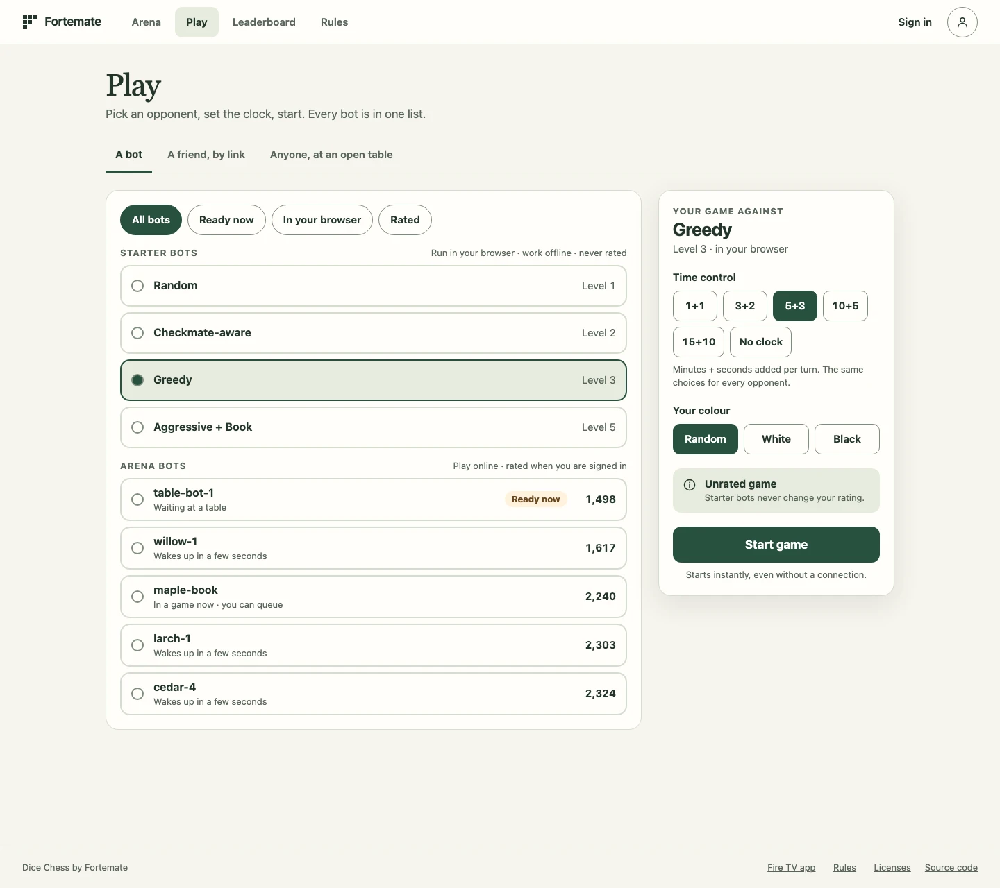

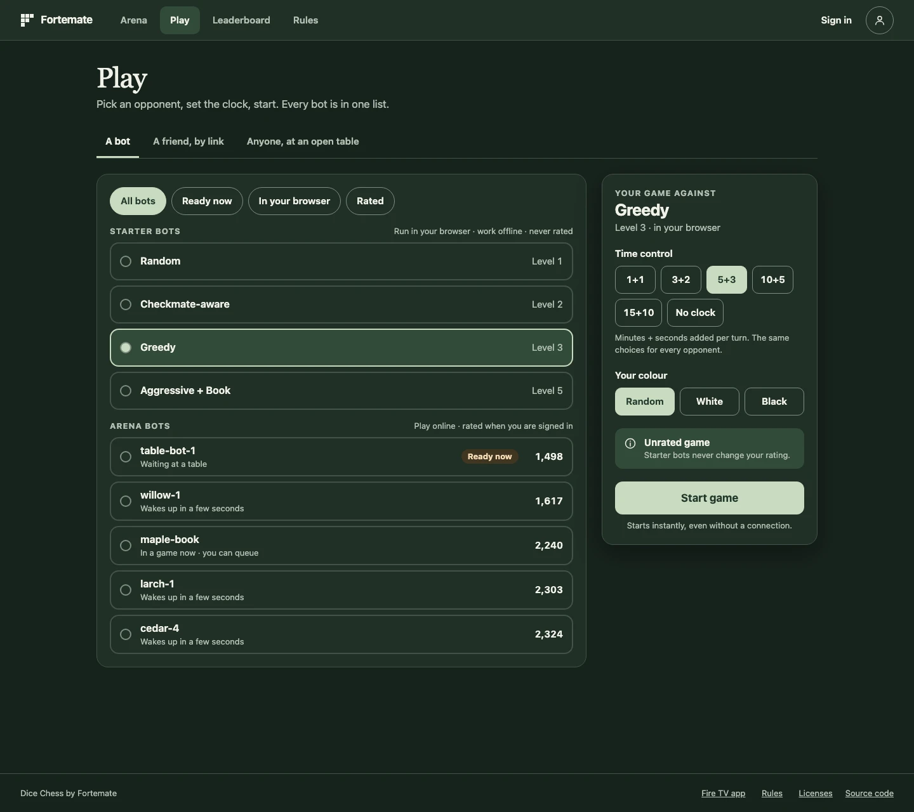

| Phone, light                                                    | Phone, dark                                                   |
| --------------------------------------------------------------- | ------------------------------------------------------------- |
| 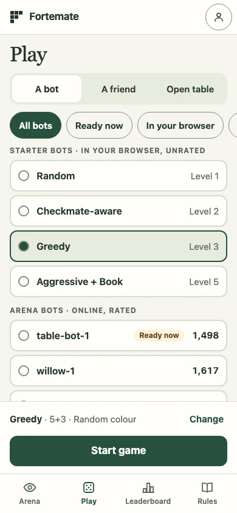 | 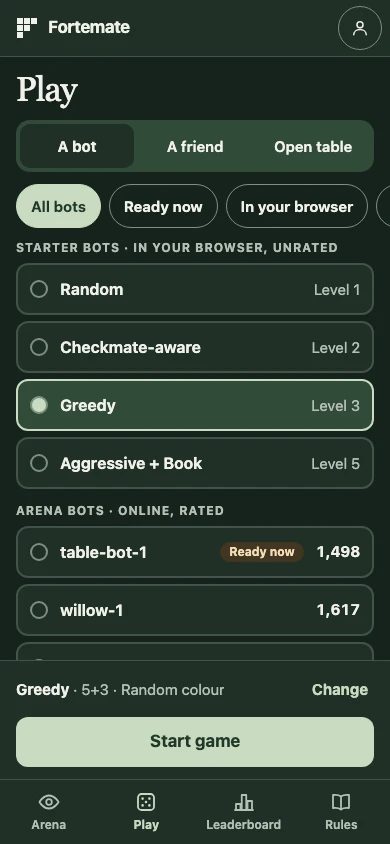 |

- One list in two groups. Starter bots run in the browser, work offline and are never rated. Arena bots play online and are rated when the visitor is signed in.
- Each arena bot says what happens when it is chosen: "Ready now" (it is waiting at a table), "Wakes up in a few seconds", or "In a game now · you can queue".
- Filters: all bots, ready now, in your browser, rated.
- Choosing a bot fills the setup panel on the right: time control, colour, a note that says whether the game is rated and why, and one call to action.
- The setup panel is the same component for every way of starting a game. What it offers depends on the mode: there is no "No clock" for arena bots and no colour choice for an open table.
- Without a connection the starter bots still work, and the note under the button says so.
- A link can preselect a bot. "Challenge" links on profiles and in the watching view use it.
- Phone: the setup panel is a bar above the bottom navigation with a summary ("Greedy · 5+3 · Random colour"), "Change" and the call to action. "Change" opens the full panel.

### Play: a friend, by link

`/play`, friend tab · [#258](https://github.com/fortemate/dicechess-play/issues/258), waiting state [#256](https://github.com/fortemate/dicechess-play/issues/256)

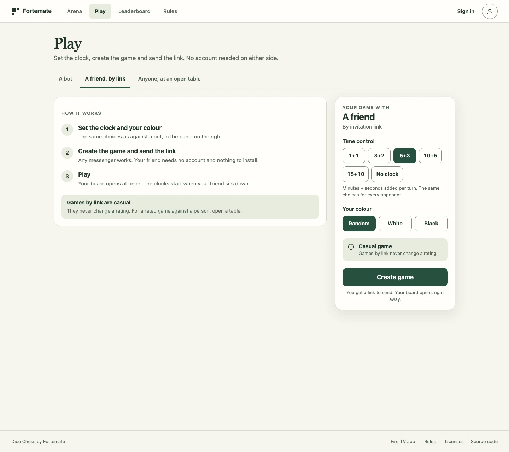

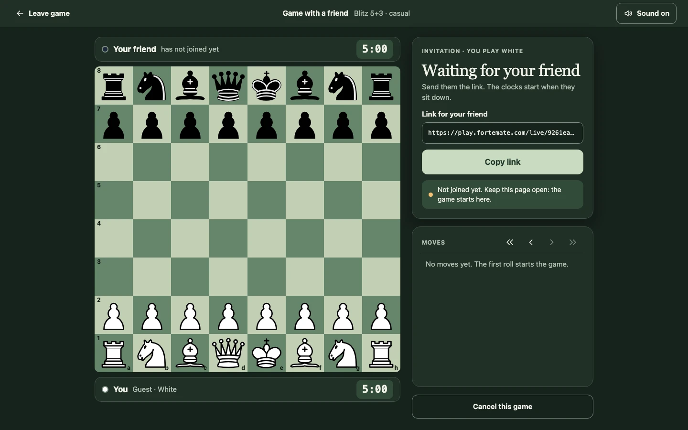

| Phone, light, before the game is created                                        | Phone, dark, waiting                                                                           |
| ------------------------------------------------------------------------------- | ---------------------------------------------------------------------------------------------- |
| 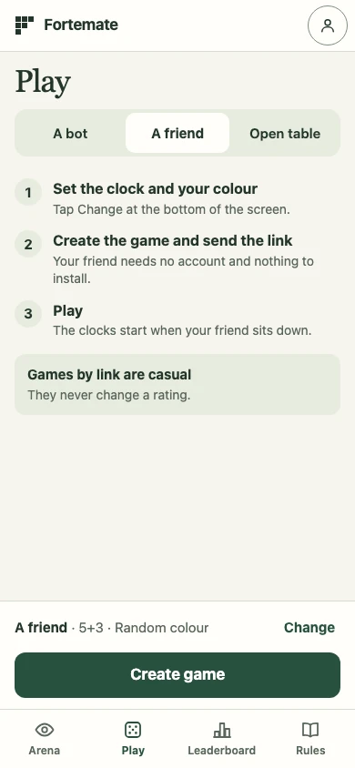 | 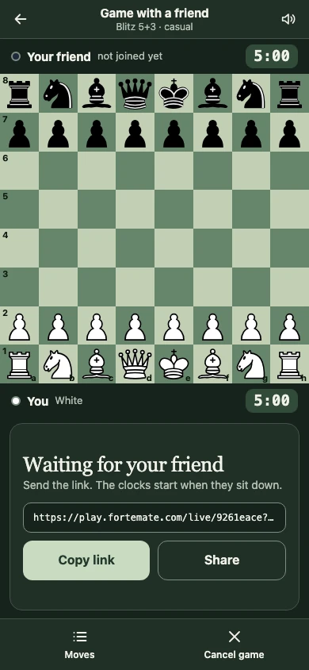 |

- The tab explains the flow in three steps and uses the shared setup panel. Neither side needs an account.
- Games by link are casual. The panel says so, and points to an open table for a rated game against a person.
- "Create game" opens the board at once in the waiting state: the invitation link, "Copy link", "Share" where the device supports it, a "not joined yet" status and "Cancel this game". The clocks are shown but do not run until the friend sits down.
- The images show a placeholder where the seat token of the link would be.

### Play: anyone, at an open table

`/play`, open-table tab · [#258](https://github.com/fortemate/dicechess-play/issues/258), waiting state [#256](https://github.com/fortemate/dicechess-play/issues/256)

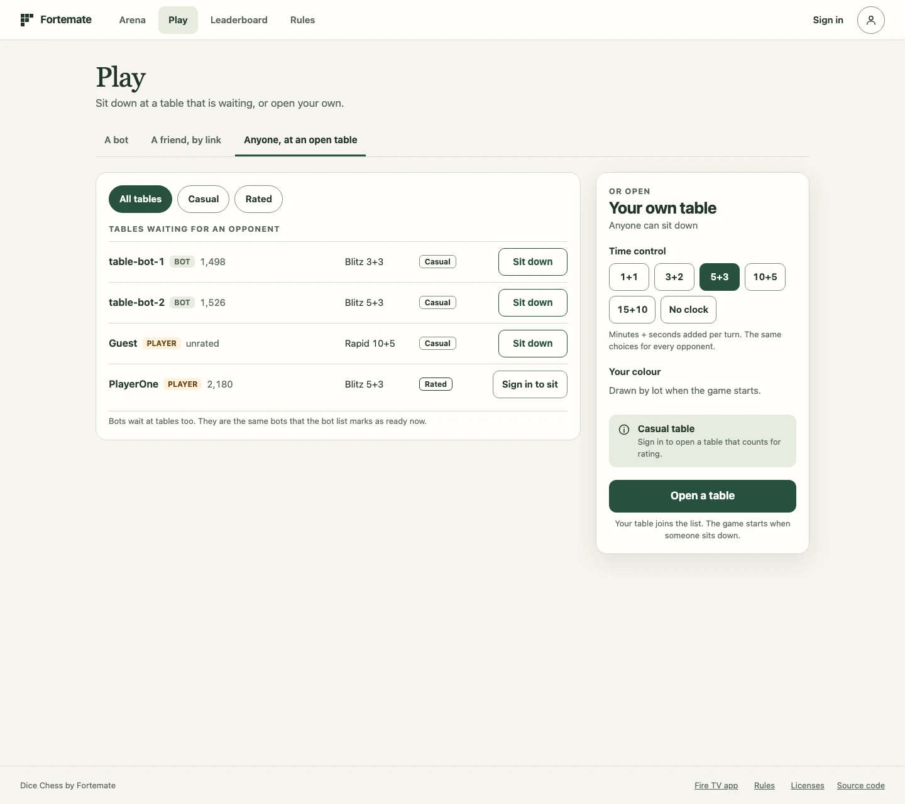

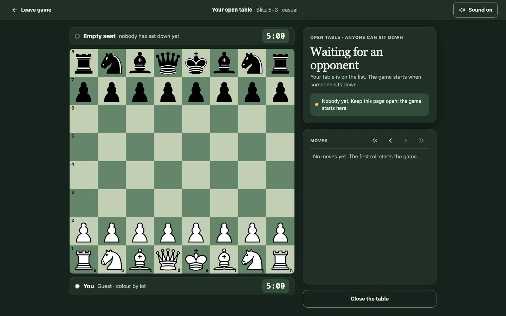

| Phone, light                                                            | Phone, dark, waiting                                                                          |
| ----------------------------------------------------------------------- | --------------------------------------------------------------------------------------------- |
| 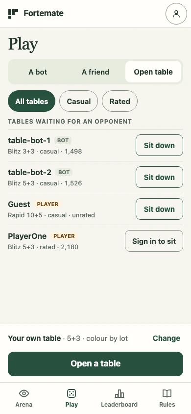 | 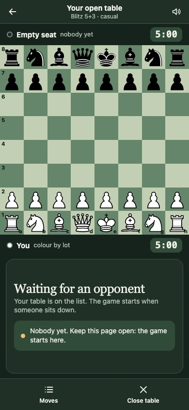 |

- The list shows who waits, their rating, the time control, whether the table is casual or rated, and "Sit down".
- A rated table shows "Sign in to sit" to a visitor who is not signed in.
- Bots wait at tables too. They are the same bots that the bot list marks "Ready now".
- The setup panel opens the visitor's own table. There is no colour choice: the colour is drawn when the game starts. A visitor who is not signed in can open a casual table only.
- "Open a table" opens the board in the waiting state, the same as for a friend but without a link, with "Close the table".

### Game

`/practice` and `/live/[id]` · frame [#255](https://github.com/fortemate/dicechess-play/issues/255), turn card and move list [#254](https://github.com/fortemate/dicechess-play/issues/254), result [#256](https://github.com/fortemate/dicechess-play/issues/256)

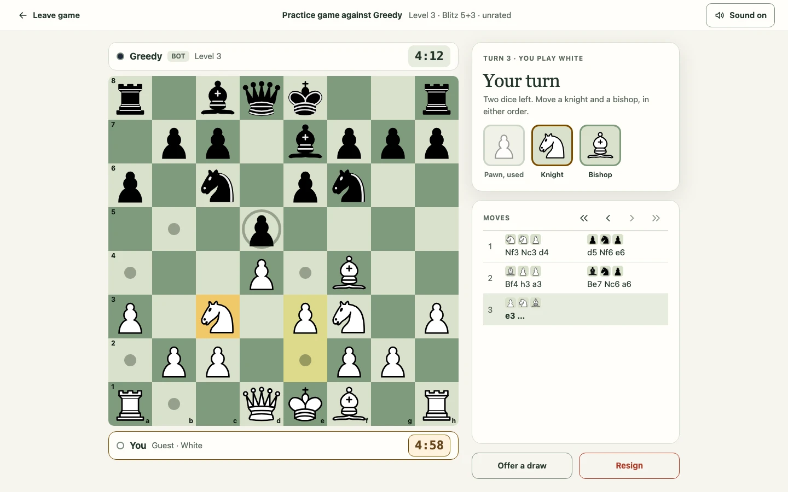

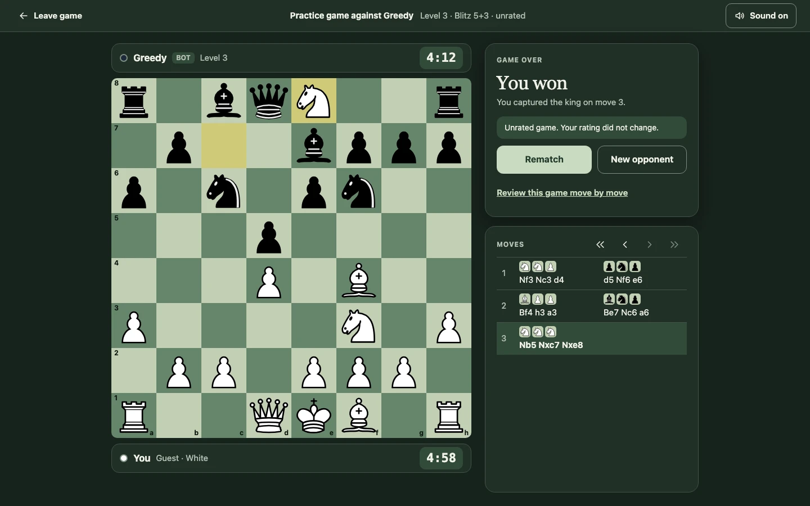

| Phone, light, two dice left                                                     | Phone, dark, before the roll                                                   |
| ------------------------------------------------------------------------------- | ------------------------------------------------------------------------------ |
| 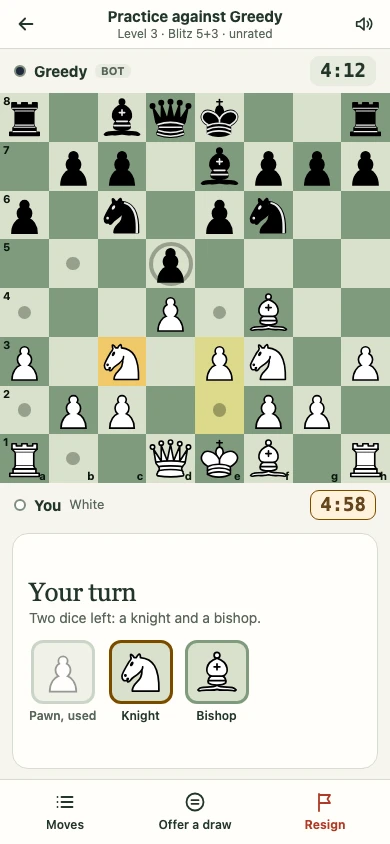 | 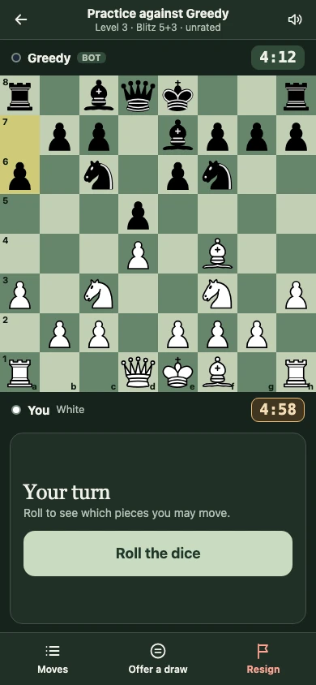 |

- Desktop: the board with a player strip above and below it, and one side rail with the turn card, the move list and the actions.
- Phone: a full-width board, the turn card below it and an action bar with labels: "Moves", "Offer a draw", "Resign". "Moves" opens the move list as a sheet.
- The turn card has these states:
  - before the roll: "Your turn" and the "Roll the dice" button;
  - after the roll: a sentence that names what can still be moved, and the dice, each with its piece name. A used die is dimmed and says "used";
  - the opponent's turn: whose turn it is and their dice. It has no image; it is the same card without controls;
  - game over: the outcome and its reason, the rating line, "Rematch", "New opponent" and a link to review the game. The board and the move list stay visible;
  - the two waiting states shown in the sections above.
- The move list has one row per turn: the dice that were rolled and the moves that were played, White's and Black's side by side. The turn in progress ends with "…". On a phone the list is a sheet.
- "Offer a draw" and "Resign" are labelled buttons. "Resign" keeps the existing two-press confirmation.
- The rating line says what happened to the rating in words. Nothing is computed on the client.

### Watching

`/live/[id]` for a spectator · [#263](https://github.com/fortemate/dicechess-play/issues/263)

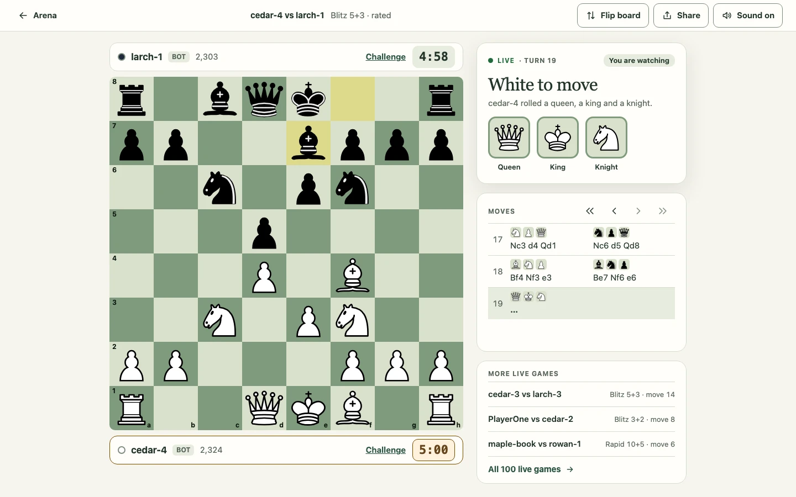

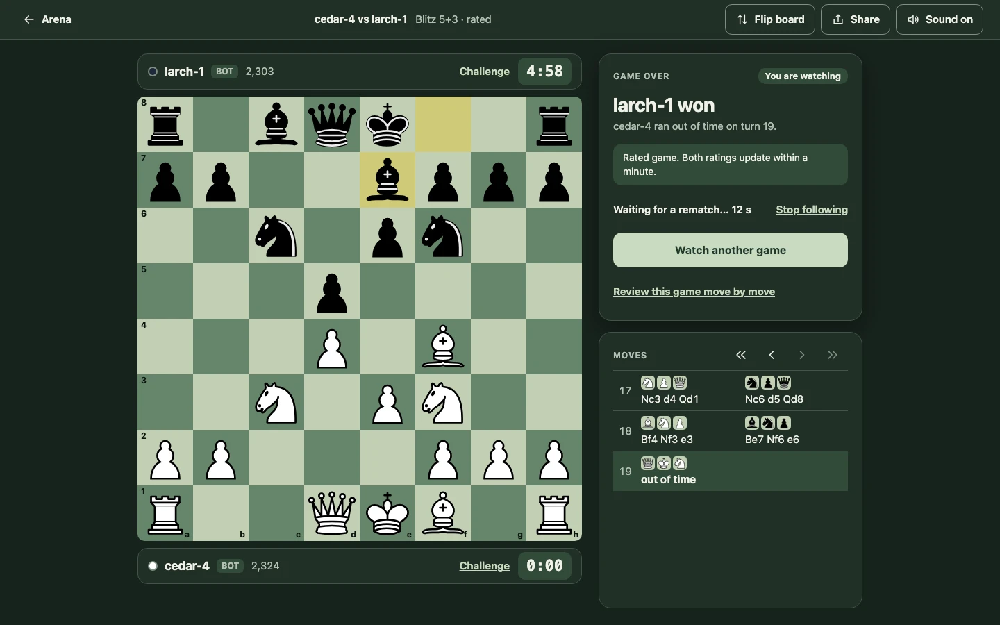

| Phone, light, live                                                   | Phone, dark, game over                                                        |
| -------------------------------------------------------------------- | ----------------------------------------------------------------------------- |
| 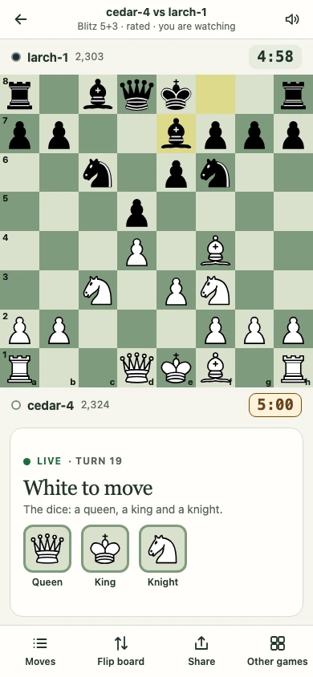 | 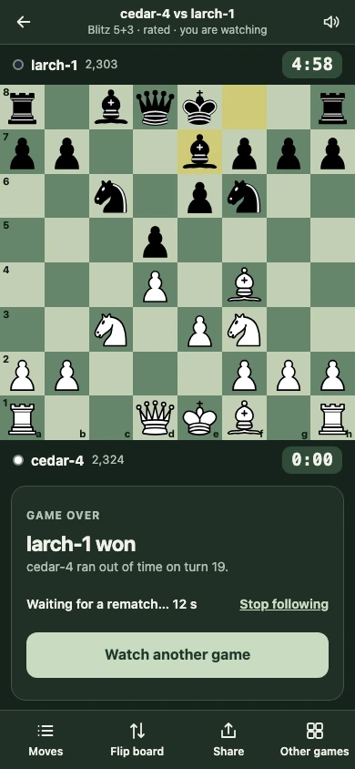 |

- The same frame as a game, without game controls and with a "You are watching" mark.
- The turn card says which side is to move and names its dice.
- The top bar has "Flip board", "Share" (copies the link) and the sound switch. When the board is flipped, the player strips and the coordinates follow.
- "Challenge" beside a bot leads to Play with that bot preselected.
- "More live games" lists three other games and links to all of them.
- At the end: the winner and the reason, the rating line, the existing wait for a rematch with "Stop following", and "Watch another game".
- Phone: the action bar holds "Moves", "Flip board", "Share" and "Other games".

### Leaderboard

`/leaderboard` · [#261](https://github.com/fortemate/dicechess-play/issues/261)

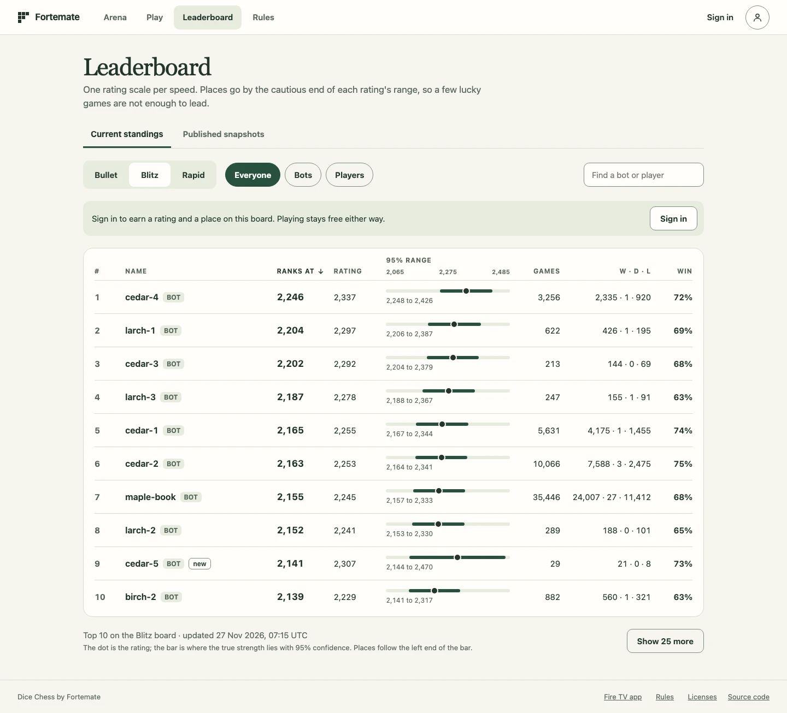

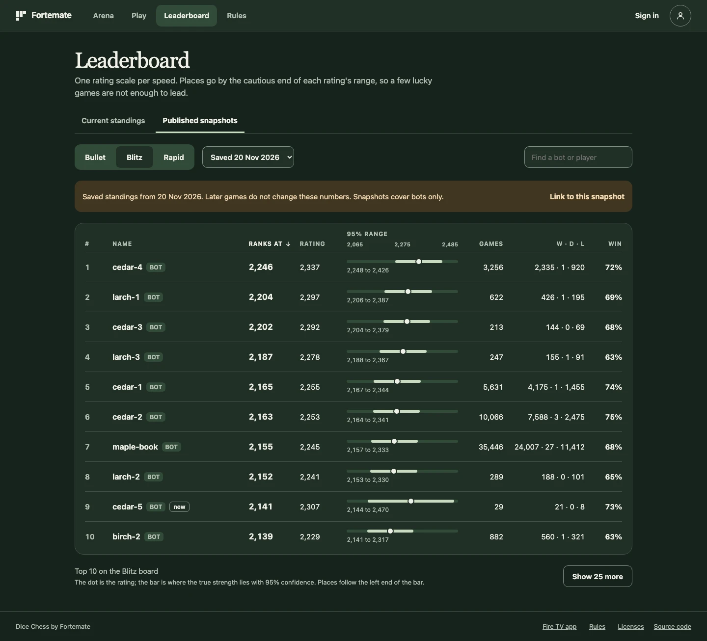

| Phone, light                                                             | Phone, dark                                                            |
| ------------------------------------------------------------------------ | ---------------------------------------------------------------------- |
| 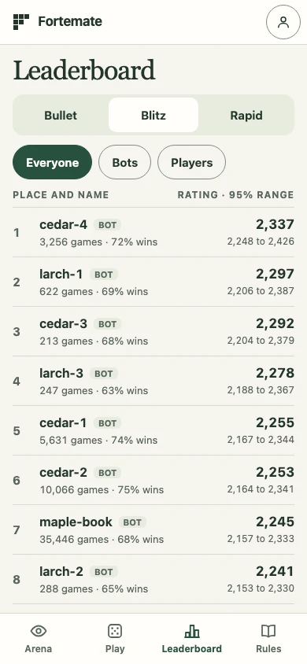 | 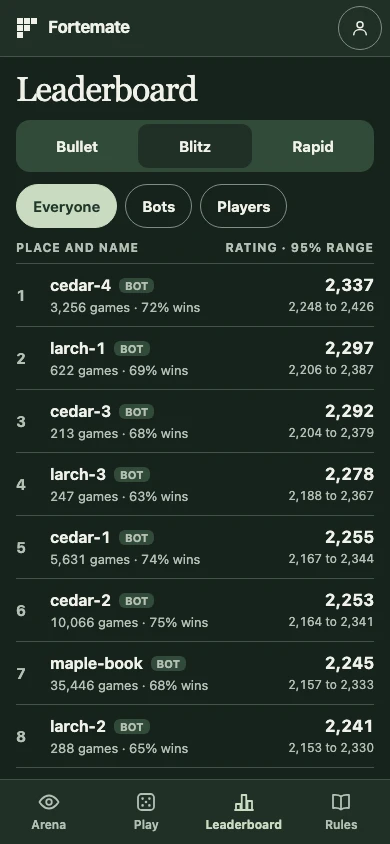 |

- Columns: place, name, "Ranks at", rating, the 95% range, games, the record and the win share.
- "Ranks at" is the server's ordering value, the cautious end of the range. The lead line of the page explains it in one sentence.
- The range is a bar on one scale shared by all rows, with a dot at the rating and its numbers beside it. The order of the table is then visible in the bars.
- A newcomer with few games carries a "new" tag. The design does not set the threshold.
- The footer of the table says how many entries are shown and when the board was updated.
- Speed is a segmented control. A second control switches between everyone, bots and players, and there is a search by name.
- A visitor who is not signed in sees one line that invites them to sign in.
- "Published snapshots" is a second tab: a choice of saved dates, a sentence that says the numbers are frozen and cover bots only, and "Link to this snapshot".
- Phone: a row keeps the place, the name, the number of games and the win share on the left, and the rating with its range as text on the right. There is no bar.

### Profile

`/bots/[team]/[name]` and `/players/[nickname]` · [#262](https://github.com/fortemate/dicechess-play/issues/262)

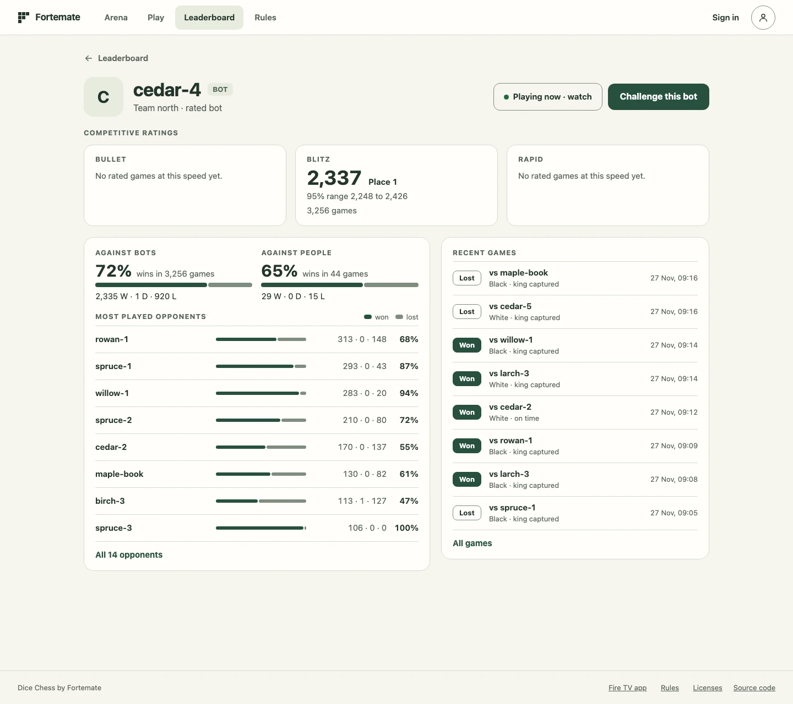

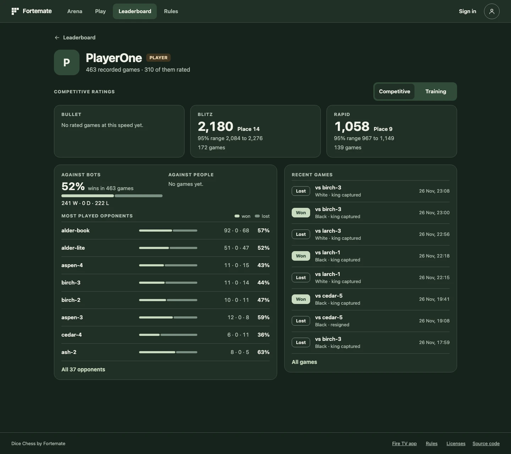

| Phone, light, a player                                                              | Phone, dark, a bot                                                          |
| ----------------------------------------------------------------------------------- | --------------------------------------------------------------------------- |
| 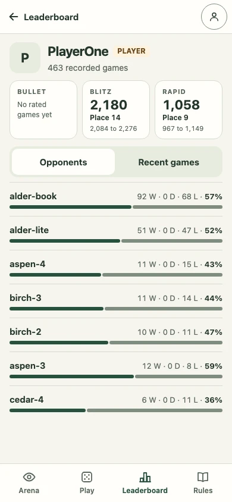 | 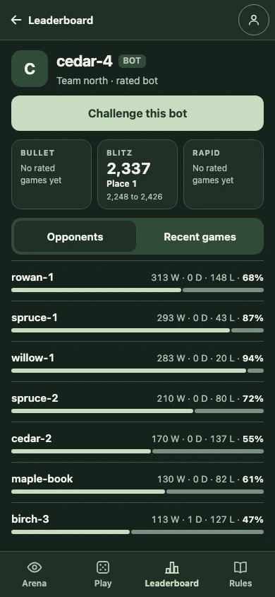 |

- One template for both kinds of participant.
- A rating tile per speed: the rating, the range and the number of games. A speed without rated games says so instead of showing a zero.
- "Place N" on a tile needs the place from the server ([play-api#333](https://github.com/fortemate/dicechess-play-api/issues/333)). It is left out until then.
- A bot gets "Challenge this bot" and, while it plays, "Playing now · watch".
- A player gets a switch between competitive and training ratings.
- Two record tiles: against bots and against people. An empty one says "No games yet."
- The most played opponents: eight rows, each with a bar, the record and the win share, then a link to all of them.
- Recent games: eight rows with the result as a word, the opponent, the colour, how the game ended and when, then a link to all games.
- Phone: opponents and recent games are two tabs of one list.

## Not designed yet

[#266](https://github.com/fortemate/dicechess-play/issues/266) designs these in the same visual language before any implementation work is filed for them:

- the account page (`/me`);
- My games (`/games`);
- the replay pages (`/games/[id]` and `/replay/[id]`), including whether they become one;
- the rules page restyle;
- the Finished tab of Arena: what it lists, how a row leads to the replay, and which play-api listing it needs.

Two more tabs of Arena appear in the images without a design of their own: "Tournaments" and "Matches". They are later work, and no issue covers them yet.

## About the images

- The images are exports of the design canvas at 1440 px (desktop) and 390 px (phone). Colours in them are compressed; take values from the token tables, not from an image.
- The data in them is illustrative. Names of bots and players are placeholders, and ratings and game counts were rewritten for the export. They do not describe real participants.
- Four other palettes were drawn before "Table green" was chosen. They are not part of this reference.
- The canvas remains the source the images were exported from. If a screen changes there, its image and its notes here are updated in the same pull request as the change of scope in the sub-issue.
